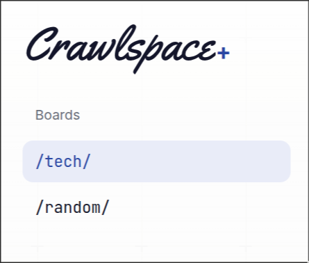
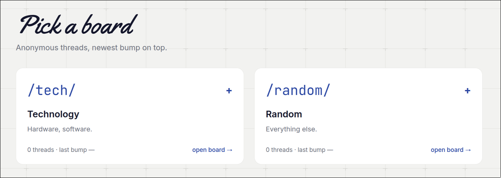
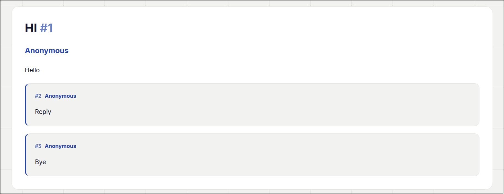
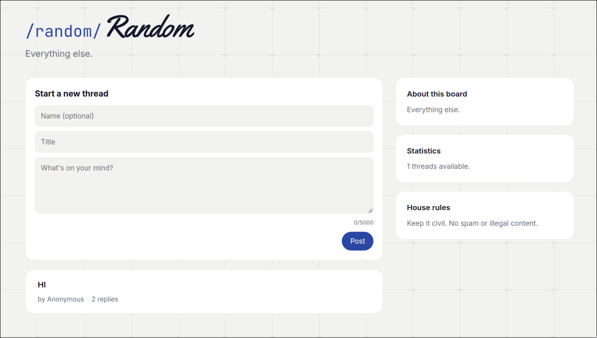
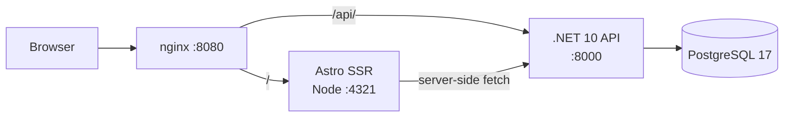

<p align="center">
  
</p>

<p align="center">
  A self-hosted, pseudonymous, text-only discussion board.
</p>

<p align="center">
  <a href="https://github.com/ncpast/crawlspace-forum/actions/workflows/deploy.yml"></a>
  
  
  
  
  
</p>

<p align="center">
  <a href="#screenshots">Screenshots</a> ·
  <a href="#architecture">Architecture</a> ·
  <a href="#engineering-highlights">Highlights</a> ·
  <a href="#quick-start">Run it</a> ·
  <a href="#api">API</a>
</p>

<p align="center">
  
</p>

## About

Crawlspace is an imageboard-style forum: pick a board, start a thread, reply. Posting needs no account, and posts are text only, with an optional name. Every post gets a site-wide number, and a thread moves to the top of its board whenever someone replies.

Six students built it as a university team project. We host it on our own Proxmox server and deploy it automatically from `main`. Equipped with a full CI/CD pipeline, a pull request can't merge until the tests pass, and each deploy is checked with smoke tests before it counts as done.

Live at [crawlspace-server.buffalo-werner.ts.net](https://crawlspace-server.buffalo-werner.ts.net/). For now the server is only reachable from our private Tailscale network (tailnet), so the link works for team members. We plan to move it to a public domain.

## Features

- Boards (`/tech/`, `/random/`), each with its own thread list
- Threads as a single linear scroll of replies, oldest first
- Bump ordering: a new reply moves its thread to the top of the board
- Site-wide post numbers shared by threads and replies (`#4727482`)
- Readable thread URLs: `/tech/thread/my-cool-setup-4727482`
- Pseudonymous posting with an optional name
- Server-side validation and per-IP rate limiting
- Server-rendered pages with interactive React forms

## Screenshots

> The posts in these screenshots are sample data.

| Boards | Home |
|---|---|
|  |  |
| **Thread** | **New thread** |
|  |  |

## Architecture



Nginx is the only container with a published port. It passes page requests to the frontend, and strips `/api/` from API calls before forwarding them to the backend.

Astro renders pages on the server and calls the API over the internal Docker network. In the browser, React components handle the forms. The backend and database publish no ports, so nothing outside the Compose network can reach them.

The schema is code-first with EF Core. Migrations are committed to the repo, and the backend applies them when it starts.

### Delivery


Pull requests run the tests on a GitHub-hosted runner, and branch protection on `main` blocks the merge if they fail. After a merge, the tests run again and a self-hosted GitHub Actions runner on our server deploys the new version. The runner opens the connection to GitHub itself, so the server needs no inbound ports. A deploy fails unless both the site and the API respond afterwards.

### Infrastructure

| Part | Setup |
|---|---|
| Host | Proxmox VE on Oleksandr's homelab, Debian Linux |
| Runtime | Docker Compose (nginx, frontend, backend, database) |
| Access | Tailscale. The tailnet serves the app over HTTPS and gives the team private access to the server, SSH and Proxmox, with no ports opened to the internet |
| Development | Teammates reach the shared server and its services through the same tailnet |
| Secrets | `.env` lives only on the server, never in the repo |

## Engineering highlights

| What | How |
|---|---|
| Post numbers shared by threads and replies | Both tables take their IDs from one Postgres sequence (`PostReplyNumbers`), so a number like `#4727482` identifies exactly one post anywhere on the site. [`AppDbContext.cs`](backend/Data/AppDbContext.cs) |
| Bump ordering | A reply updates its thread's `BumpedAt` in the same transaction as the insert. Board pages read from an index on `(BoardId, BumpedAt DESC)`. |
| No N+1 queries | Responses are DTOs projected inside the query. Reply counts come from a SQL subquery, so a board page is one query. [`Program.cs`](backend/Program.cs) |
| DTOs separate from entities | Clients can't set IDs or timestamps. The server assigns them. [`Dtos/`](backend/Dtos) |
| Rate limiting by real client IP | Fixed-window limits per IP: 3 threads, 10 replies and 120 reads per minute. The client IP comes from `X-Forwarded-For`, trusted only from the nginx proxy. [`RateLimitingExtensions.cs`](backend/Extensions/RateLimitingExtensions.cs) |
| URL slugs | Titles become URL slugs, with Polish and other diacritics transliterated (`Zażółć` → `zazolc`), capped at 60 characters. [`SlugGenerator.cs`](backend/Dtos/SlugGenerator.cs) |
| Tests | 46 xUnit tests: endpoints, validation, bump ordering, rate limiting, slug generation and the JSON contract. [`backend.Tests/`](backend.Tests) |
| CI/CD | Tests block failing PRs, `main` deploys automatically, and smoke tests check each rollout. [`.github/workflows/`](.github/workflows) |

## Tech stack

| Layer | Tech |
|---|---|
| Frontend | Astro (server-side rendering, Node adapter), React 19, TypeScript |
| Backend | .NET 10 minimal API, EF Core, Npgsql |
| Database | PostgreSQL 17 |
| Proxy | nginx |
| Containers | Docker, Docker Compose |
| CI/CD | GitHub Actions, self-hosted runner |
| Tests | xUnit |
| Hosting | Proxmox VE, Tailscale, Cloudflare |

## Quick start

Requires Docker.

```bash
git clone https://github.com/ncpast/crawlspace-forum.git
cd crawlspace-forum
cp .env.example .env          # Windows: copy .env.example .env
docker compose up -d --build
```

Open http://localhost:8080. The `tech` and `random` boards are created automatically.

To work on the code with hot reload, see [docs/DEVELOPMENT.md](docs/DEVELOPMENT.md). To contribute, see [CONTRIBUTING.md](CONTRIBUTING.md).

## API

Served under `/api/` through nginx (`http://localhost:8080/api/boards`).

| Method | Route | Returns |
|---|---|---|
| `GET` | `/boards` | All boards |
| `GET` | `/boards/{board}/posts` | Up to 50 threads, most recently bumped first |
| `GET` | `/boards/{board}/posts/{publicId}` | A thread with its replies, oldest first |
| `POST` | `/boards/{board}/posts` | `201` with the new thread |
| `POST` | `/boards/{board}/posts/{publicId}/replies` | `201` with the new reply, bumps the thread |
| `GET` | `/health` | `{ "status": "ok" }` |

Limits: title 100 characters, content 5000, name 30. Invalid input returns `400` with a message, an unknown board or thread returns `404`, and exceeding a rate limit returns `429`.

## Roadmap

- [x] Boards, threads and replies
- [x] Bump ordering and site-wide post numbers
- [x] Validation and per-IP rate limiting
- [x] Test gate and automatic deployment
- [ ] `>>number` mentions that link to the quoted post
- [ ] Public domain
- [ ] Admin accounts and moderation (deleting posts)
- [ ] Pagination
- [ ] Integration tests against a real PostgreSQL in CI
- [ ] Database backups

## Credits

| | Role |
|---|---|
| Oleksandr ([@ncpast](https://github.com/ncpast)) | Team and Technical Lead: Architecture, CI/CD, Server Administration, Test Suite, Logo and UI Design |
| Myroslav ([@Rudnikua](https://github.com/Rudnikua)) | Backend Developer: Read and Create Endpoints, Validation and Bumping, DTOs and Slug Generator, Endpoint Tests |
| Yehor ([@YehorA](https://github.com/YehorA)) | Backend Developer: Rate Limiting, Real Client IP Forwarding through nginx, Rate Limiting Tests |
| Volodymyr ([@Fenix085](https://github.com/Fenix085)) | Frontend Developer: Base Layout, API Client, Board and Thread Pages, New Thread Form, Error Pages |
| Borys ([@hutor-hash](https://github.com/hutor-hash)) | Frontend Developer: Visual Design and Styling, Reply Form, Client-Side Validation |
| Dmytro ([@Dimamosik](https://github.com/Dimamosik)) | Database: Schema Design, Migrations, Seed Data |